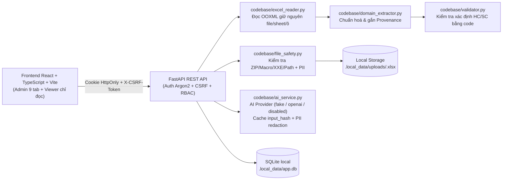

# Kiến trúc hệ thống — Trợ lý Tổng hợp & Kiểm tra Lịch Đào tạo AI20K (Track A5)

## 1. Sơ đồ tổng thể

## 2. Phân tách trách nhiệm

- **Tầng đọc & kiểm tra xác định (`codebase/`):**
  - `excel_reader.py`: tầng nhập duy nhất, giữ nguyên `source_cell`, vùng ô gộp và hyperlink.
  - `file_safety.py`: kiểm tra kích thước, định dạng `.xlsx`, chống ZIP bomb, VBA macro, ActiveX/OLE, XXE, formula injection, phát hiện và ẩn danh PII.
  - `domain_extractor.py`: hợp nhất dữ liệu nhiều sheet (`Khoá 9 (GĐ1)`, `Lịch lớp K9 (bản chép)`, `Lịch lab`, `Nhan_su`, `Đổi buổi`, `Learners`, và bảng tuỳ biến) kèm `provenance_json`.
  - `validator.py`: thực thi 100% bằng code thuần cho Hard Constraints (`HC-REQ`, `HC-01`, `HC-02`, `HC-03`, `HC-09`, `HC-11`, `HC-ROOM-STATUS`, `HC-SOURCE-CONFLICT`, `HC-MAPPING-PENDING`) và cảnh báo (`HC-07-DATA`, `HC-INJECTION-CELL`, `SC-SWAP-UNSYNCED`, `SC-STAFF-ALIAS`).
  - `ai_service.py`: chỉ tạo gợi ý mapping có cấu trúc kèm độ tự tin/lý do, có cache theo `input_hash`, giới hạn ngân sách và không bao giờ tự xác nhận Hard Constraint hay tự publish.
- **Tầng Backend (`backend/`):**
  - SQLAlchemy 2 + SQLite (12 bảng, khóa ngoại, index, migration qua Alembic).
  - Xác thực Argon2 + session token lưu hash SHA-256 trong `user_sessions` + chống CSRF + rate-limit đăng nhập sai.
  - Transaction cô lập khi `publish`: chuyển bản cũ sang `superseded`, lưu bản mới `published`, chống double-submit bằng `publish_key`.
- **Tầng Frontend (`frontend/`):**
  - Giao diện tiếng Việt, responsive, hỗ trợ Sáng/Tối và bàn phím.
  - Khi đăng nhập với vai trò `Viewer`, chỉ hiển thị duy nhất màn hình lịch công bố từ `/api/public/schedule`.
